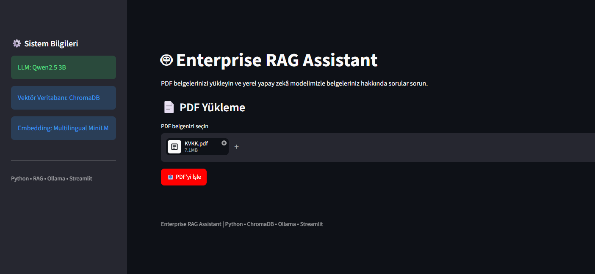
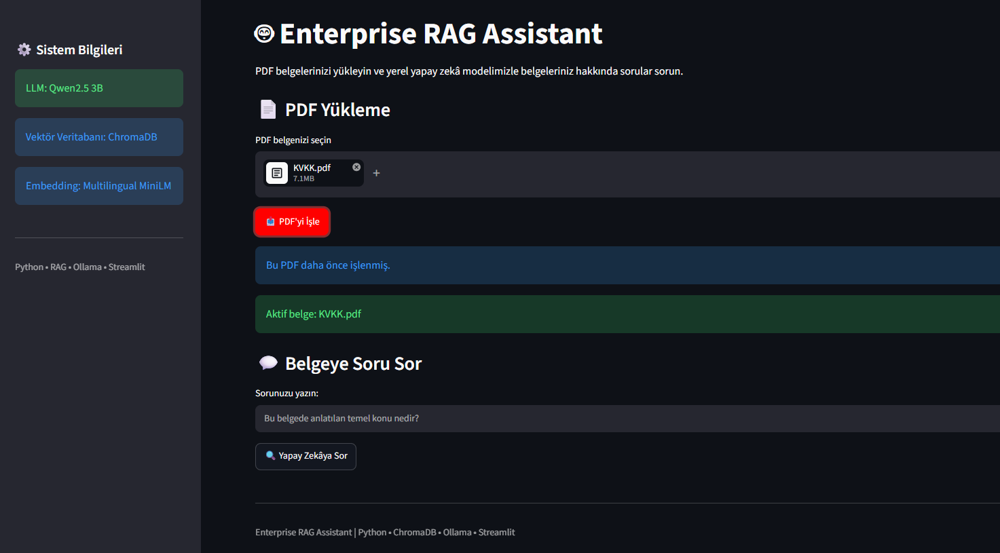
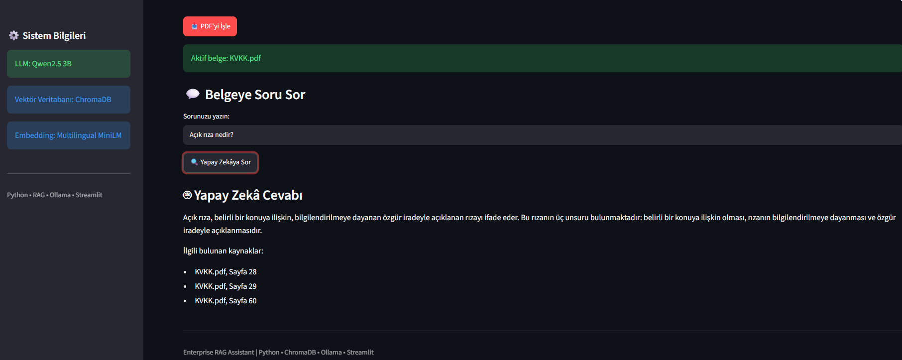
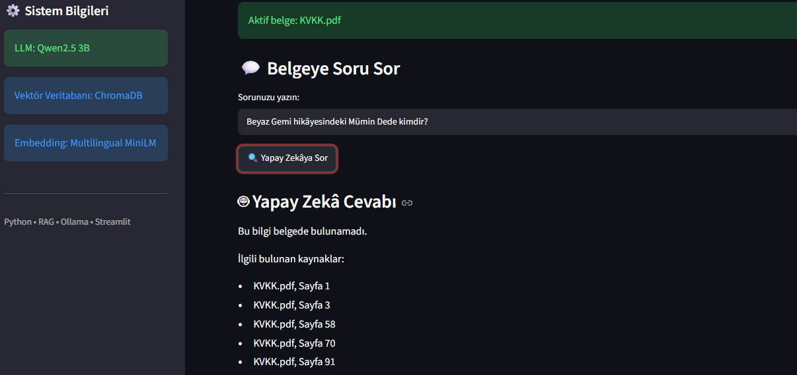

# Enterprise RAG Assistant

Python, ChromaDB, Ollama ve Streamlit kullanarak geliştirdiğim, PDF belgeleri üzerinde anlamsal arama yapabilen yerel bir RAG uygulaması.

Uygulama, yüklenen PDF belgelerindeki metinleri işler ve kullanıcının sorularını ilgili belge içeriklerinden yararlanarak yanıtlamaya çalışır.

## Projenin Amacı

Bu projeyi Retrieval-Augmented Generation (RAG) mimarisini uygulamalı olarak öğrenmek ve bir dil modelinin harici belgelerden nasıl yararlanabildiğini incelemek amacıyla geliştirdim.

Çalışma boyunca özellikle şu konulara odaklandım:

- PDF belgelerinden metin çıkarma
- Metinleri daha küçük parçalara ayırma (Chunking)
- Metinleri embedding vektörlerine dönüştürme
- Vektör veritabanında anlamsal arama
- Yerel dil modeliyle soru-cevap üretme
- Belge bazlı arama ve kaynak gösterimi
- Arama sonuçlarının ve üretilen cevapların değerlendirilmesi

Proje, çalışan bir prototip olarak geliştirildi. Testlerde tespit ettiğim eksiklikleri ve olası iyileştirme yöntemlerini de dokümantasyona ekledim.

## Kullanılan Teknolojiler

| Teknoloji | Kullanım Amacı |
|---|---|
| Python | Uygulama geliştirme |
| Streamlit | Web arayüzü |
| Ollama | Yerel dil modeli çalıştırma |
| Qwen2.5 3B | Cevap üretme |
| ChromaDB | Vektör veritabanı |
| Multilingual MiniLM | Embedding oluşturma |
| Semantic Search | Anlamsal arama |
| Query Expansion | Arama sorgularını genişletme |
| Reciprocal Rank Fusion (RRF) | Arama sonuçlarını birleştirme |

## Uygulamanın Özellikleri

- PDF dosyası yükleme
- PDF içeriğini metin parçalarına ayırma
- Metin parçalarını ChromaDB üzerinde saklama
- Yüklenen belgeler üzerinde anlamsal arama yapma
- Yerel LLM ile Türkçe cevap üretme
- Kullanılan kaynak dosyalarını ve sayfa numaralarını gösterme
- Belge kimliğine göre arama yapma
- Aynı PDF dosyasının tekrar işlenmesini önleme
- Streamlit üzerinden kullanıcı etkileşimi

PDF dosyaları SHA-256 algoritmasıyla oluşturulan belge kimlikleri üzerinden takip ediliyor.

Bu sayede daha önce işlenmiş belgelerin yeniden veritabanına eklenmesi önlenebiliyor.

## Sistem Nasıl Çalışıyor?

Uygulama iki temel aşamadan oluşuyor.

### 1. PDF İşleme

Kullanıcı PDF dosyasını yüklediğinde:

1. PDF içindeki metinler okunuyor.
2. Metinler daha küçük parçalara ayrılıyor.
3. Her metin parçasının embedding vektörü oluşturuluyor.
4. Vektörler, metinler ve kaynak bilgileri ChromaDB'ye kaydediliyor.
5. Belgeye ait bir kimlik oluşturularak sonraki sorgularda kullanılabiliyor.

### 2. Soru-Cevap

Kullanıcı bir soru sorduğunda:

1. Soru embedding vektörüne dönüştürülüyor.
2. Desteklenen soru türlerinde alternatif arama sorguları oluşturuluyor.
3. ChromaDB üzerinde ilgili metin parçaları aranıyor.
4. Arama sonuçları RRF yöntemiyle birleştirilerek sıralanıyor.
5. Seçilen metinler Qwen2.5 modeline bağlam olarak gönderiliyor.
6. Model bu metinlerden yararlanarak cevap üretiyor.
7. Uygulama cevabı ve aramada kullanılan kaynak sayfalarını gösteriyor.

## Ekran Görüntüleri

### Ana Ekran



### PDF İşleme ve Soru Sorma



### Örnek Soru-Cevap



### Belge İzolasyonu



## Geliştirme Sürecinde Karşılaştığım Problemler

Projenin ilk aşamasında temel semantic search yapısını oluşturdum.

Ancak testlerde bazı soruların yanlış veya eksik cevaplandığını fark ettim.

Bu durumun yalnızca dil modelinden kaynaklanmadığını, arama sırasında seçilen metin parçalarının da cevap kalitesini etkileyebildiğini gördüm.

### 1. Anlamsal Arama Problemi

İlk testlerde ilgili bilgi belgede bulunmasına rağmen bazı sorularda doğru metin parçası üst sıralara gelmiyordu.

Örneğin, Beyaz Gemi belgesi üzerinde çocuğun kiminle yaşadığına ilişkin sorularda farklı sayfalardan sonuçlar getiriliyordu.

Bu sorunu incelemek için arama sonuçlarının cosine distance değerlerini ve kaynak metinlerini karşılaştırdım.

Daha sonra sorgu genişletme ve Reciprocal Rank Fusion yöntemlerini uyguladım.

Bu değişikliklerin ardından bazı test sorularında ilgili kaynakların sıralamasında iyileşme gözlemledim.

Ancak bu iyileştirmeler bütün sorularda doğru cevap alınmasını sağlamadı.

### 2. Yanlış veya Eksik Cevaplar

Bazı durumlarda model ilgili belge parçalarını bulmasına rağmen sorunun cevabını yanlış yorumladı.

Örneğin karakter ilişkileri ve neden-sonuç sorularında hatalı açıklamalar oluşturabildi.

Bazı sorularda ise doğru bilgi belgede bulunmasına rağmen:

"Bu bilgi belgede bulunamadı."

cevabını verdi.

Bu durum, yalnızca ilgili belge parçalarını bulmanın yeterli olmadığını; cevap üretme aşamasının da ayrıca değerlendirilmesi gerektiğini gösterdi.

### 3. Kaynak Gösterimi

Uygulama cevapların altında kaynak dosyalarını ve sayfa numaralarını gösteriyor.

Ancak listelenen sayfalar aramada kullanılan metin parçalarına ait.

Bu nedenle her kaynak sayfasının üretilen cevabı doğrudan desteklediği garanti edilmiyor.

Gelecekte cevap içerisindeki iddialarla kaynak metinlerin eşleştirilmesini sağlayan bir doğrulama mekanizması eklemeyi planlıyorum.

## Test ve Değerlendirme

Uygulamayı iki farklı PDF belgesi üzerinde test ettim:

- Beyaz Gemi: Edebî metin
- KVKK: Bilgilendirici ve hukuki metin

Toplam 15 soru üzerinden manuel bir değerlendirme gerçekleştirdim.

Cevapları doğru, kısmen doğru ve yanlış olmak üzere üç kategoride inceledim.

### Test Sonuçları

| Belge | Soru Sayısı | Doğru | Kısmen Doğru | Yanlış |
|---|---:|---:|---:|---:|
| Beyaz Gemi | 10 | 3 | 2 | 5 |
| KVKK | 5 | 0 | 5 | 0 |
| Toplam | 15 | 3 | 7 | 5 |

Bu sonuçlar sınırlı sayıdaki test sorularına dayanmaktadır.

Dolayısıyla sistemin genel doğruluk oranını temsil eden kapsamlı bir benchmark olarak değerlendirilmemelidir.

### Testlerdeki Gözlemlerim

- Doğrudan bilgi içeren bazı sorular doğru yanıtlandı.
- Karakter ilişkileri ve yorumlama gerektiren sorularda daha fazla hata görüldü.
- Bazı cevaplar temel bilgiyi doğru aktarsa da eksik kaldı.
- Model zaman zaman belgede bulunan bilgiye ulaşamadığını belirtti.
- Kaynak listeleri her zaman cevapları doğrudan desteklemiyordu.

### Belge İzolasyonu Testi

Aynı veritabanında bulunan iki farklı PDF belgesinin birbirine karışıp karışmadığını kontrol ettim.

İlk testte KVKK belgesi aktifken Beyaz Gemi hakkında soru sordum.

İkinci testte Beyaz Gemi belgesi aktifken KVKK ile ilgili bir soru sordum.

Her iki testte de model, seçili belgede bulunmayan bilgi için cevap vermedi.

Ayrıca listelenen kaynakların aktif belgeye ait olduğunu gözlemledim.

Sonuç: 2/2 belge izolasyonu testi başarılı.

Bu sonuç, test edilen senaryolarda belge filtrelemesinin çalıştığını gösteriyor. Daha kapsamlı güvenlik ve izolasyon testleri yapılmadı.

## Mevcut Eksiklikler

Projenin şu anda geliştirilmesi gereken noktaları:

- Bazı sorularda ilgili metin parçalarının yeterince iyi sıralanamaması
- Dil modelinin zaman zaman yanlış çıkarımlar üretmesi
- Cevapların eksik kalabilmesi
- Kaynak sayfalarının doğrudan kanıt olarak doğrulanmaması
- Otomatik doğruluk değerlendirmesinin bulunmaması
- Taranmış ve metin katmanı olmayan PDF dosyalarının doğrudan işlenememesi

Bu eksiklikleri projenin sonraki sürümlerinde ele alınabilecek geliştirme alanları olarak değerlendiriyorum.

## Planlanan İyileştirmeler

### Cross-Encoder Reranking

İlk arama sonuçlarının ikinci bir modelle yeniden sıralanması, soruyla daha doğrudan ilişkili metin parçalarının seçilmesine yardımcı olabilir.

### RAG Evaluation

Daha geniş bir soru-cevap veri seti oluşturarak retrieval ve generation aşamalarını ayrı ayrı değerlendirmeyi planlıyorum.

Bu kapsamda Recall@K, answer correctness ve faithfulness gibi metriklerden yararlanılabilir.

### Kaynak Doğrulama

Üretilen cevapların ilgili kaynak metinlerle daha ayrıntılı eşleştirilmesini sağlayan bir mekanizma geliştirilebilir.

### Model Karşılaştırması

Farklı yerel dil modelleri kullanılarak cevap doğruluğu, hız ve kaynak tüketimi açısından karşılaştırma yapılabilir.

### API Entegrasyonu

Uygulamanın yalnızca Streamlit arayüzü üzerinden değil, FastAPI aracılığıyla servis olarak kullanılabilmesi sağlanabilir.

## Proje Dosyaları

```text
enterprise-rag-assistant/
|
|-- app.py
|-- embedding.py
|-- pdf_reader.py
|-- rag_assistant.py
|-- semantic_search.py
|-- text_chunker.py
|-- vector_store.py
|
|-- screenshots/
|   |-- 01-main-interface.png
|   |-- 02-pdf-processed-and-question-area.png
|   |-- 03-sample-question-answer.png
|   |-- 04-document-isolation.png
|
|-- README.md
```

## Yerel Çalıştırma

Uygulama yerel ortamda Python, Ollama ve gerekli Python kütüphaneleri kullanılarak çalıştırılmaktadır.

Kullanılan dil modeli:

`qwen2.5:3b`


### Kurulum Adımları

Bu proje Windows ortamında geliştirilmiştir. Uygulamayı yerel bilgisayarınızda çalıştırmak için Python ve Ollama kurulu olmalıdır.

**1. Projeyi bilgisayarınıza indirin**

GitHub üzerinden projeyi ZIP olarak indirebilir veya Git ile klonlayabilirsiniz. Ardından terminalde proje klasörünü açın.

**2. Python sanal ortamını oluşturun (PowerShell)**

```powershell
python -m venv .venv
```

**3. Python kütüphanelerini yükleyin**

```powershell
.\.venv\Scripts\python.exe -m pip install -r requirements.txt
```

**4. Ollama modelini hazırlayın**

Ollama uygulamasını https://ollama.com adresinden kurun. Ardından terminalde şu komutu çalıştırın:

```powershell
ollama pull qwen2.5:3b
```

Ollama servisinin çalışır durumda olması gerekir.

**5. Streamlit uygulamasını başlatın**

```powershell
.\.venv\Scripts\python.exe -m streamlit run app.py
```

Terminalde gösterilen yerel adresi (genellikle http://localhost:8501) tarayıcıda açın.

**6. PDF yükleyin ve soru sorun**

Uygulama üzerinden metin içeren bir PDF yükleyin, **PDF'yi İşle** butonuna basın ve belge hakkında soru sorun.

**Notlar:**
- İlk kullanımda embedding modeli indirileceğinden internet bağlantısı gerekebilir.
- Taranmış, yalnızca görüntü içeren PDF'ler için OCR desteği henüz bulunmamaktadır.
- `chroma_db` klasörü uygulama çalışırken yerel olarak oluşturulur. Bu veriler GitHub'a yüklenmez.


## Sonuç

Bu projede bir RAG uygulamasının temel bileşenlerini bir araya getirerek çalışan bir prototip oluşturdum.

Geliştirme sürecinde yalnızca sistemin çalışmasına değil, cevapların doğruluğuna ve arama sonuçlarının kalitesine de odaklandım.

Yaptığım testler, retrieval ve generation aşamalarının ayrı ayrı değerlendirilmesi gerektiğini görmemi sağladı.

Mevcut eksiklikleri ve iyileştirme önerilerini dokümante ederek sonraki geliştirmeler için bir yol haritası oluşturdum.

Bu proje, RAG mimarisini uygulamalı olarak öğrenme ve yapay zekâ sistemlerinde karşılaşılan problemleri analiz etme sürecimin bir parçasıdır.

---

**Not:** Bu uygulama öğrenme ve prototip geliştirme amacıyla hazırlanmıştır. Üretilen cevaplar hatalı veya eksik olabilir. Özellikle hukuki bilgiler için orijinal kaynaklar kontrol edilmelidir.
